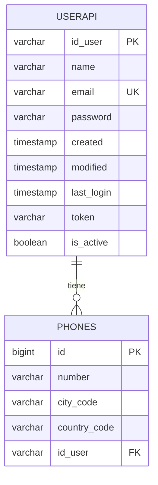
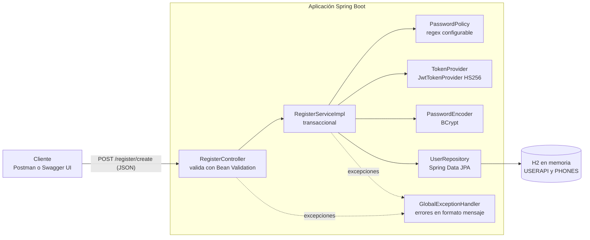
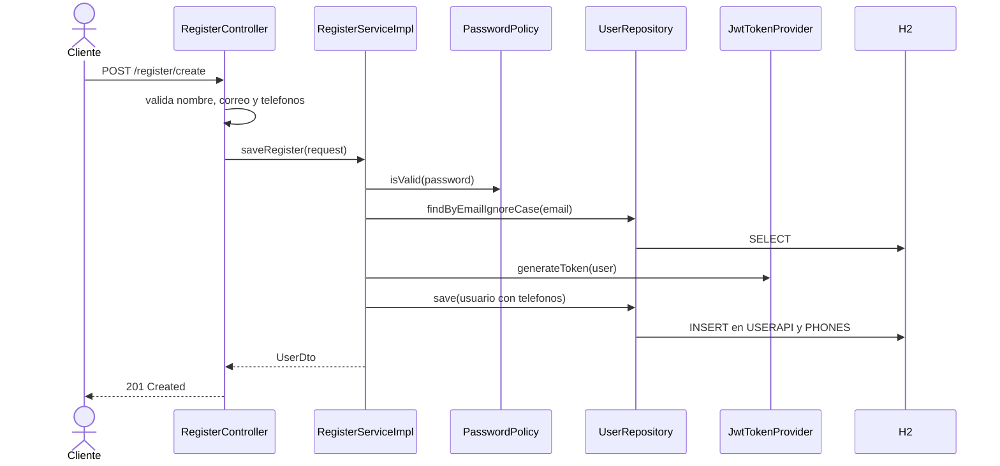

# API de registro de usuarios

API RESTful que crea usuarios y devuelve un token JWT. Es la solución a la prueba técnica «Evaluación: JAVA».

- Todos los endpoints aceptan y retornan **solo JSON**, incluso los errores, que siempre tienen el formato `{"mensaje": "..."}`.
- Contraseñas almacenadas con **hash BCrypt**; token **JWT firmado (HS256)** persistido junto al usuario.

## Tecnologías

| Área | Tecnología |
|---|---|
| Lenguaje | Java 17 |
| Framework | Spring Boot 4.1 (Spring MVC, Spring Data JPA, Bean Validation) |
| Persistencia | JPA con Hibernate, base de datos **H2 en memoria** |
| Build | Maven (incluye Maven Wrapper) |
| Token | JWT con jjwt 0.12 |
| Hash de contraseña | BCrypt (`spring-security-crypto`) |
| Documentación | OpenAPI / Swagger UI (springdoc 3.2) |
| Pruebas | JUnit 5, Mockito, Spring Test (`MockMvc`) |

## Requisitos

- **JDK 17 o superior** (no hace falta instalar Maven: el proyecto incluye el wrapper `mvnw`).
- Puerto **8080** libre.

## Cómo ejecutarlo

```bash
git clone https://github.com/JhonLizcano/Nisum.git
cd Nisum
./mvnw spring-boot:run          # en Windows: mvnw.cmd spring-boot:run
```

También se puede generar y ejecutar el jar:

```bash
./mvnw clean package
java -jar target/restfulapi-0.0.1-SNAPSHOT.jar
```

Cuando arranca, quedan disponibles:

| Recurso | URL |
|---|---|
| Swagger UI | http://localhost:8080/swagger-ui.html |
| Especificación OpenAPI (JSON) | http://localhost:8080/v3/api-docs |
| Consola de H2 | http://localhost:8080/h2-console (JDBC URL `jdbc:h2:mem:nisum`, usuario `admin`, contraseña `123`) |

## Cómo probarlo

### 1. Con Swagger UI (lo más rápido)

1. Abrir http://localhost:8080/swagger-ui.html.
2. Expandir `POST /register/create` y pulsar **Try it out**.
3. Usar el cuerpo de ejemplo (cambiar el correo si ya se usó) y pulsar **Execute**. Debe responder `201`.
4. Ejecutar de nuevo con el mismo correo: responde `409`.

### 2. Con curl

```bash
curl -i -X POST http://localhost:8080/register/create \
  -H "Content-Type: application/json" \
  -d '{"name":"Juan Rodriguez","email":"juan@rodriguez.org","password":"hunter2","phones":[{"number":"1234567","citycode":"1","countrycode":"57"}]}'
```

### 3. Con Postman

Importar `Nisum.postman_collection.json` y ejecutarla con **Run collection**. Cada petición trae sus pruebas de status y de cuerpo.

### 4. Pruebas automáticas

```bash
./mvnw clean verify
```

## Contrato de la API

### `POST /register/create`

Cuerpo:

```json
{
  "name": "Juan Rodriguez",
  "email": "juan@rodriguez.org",
  "password": "hunter2",
  "phones": [
    { "number": "1234567", "citycode": "1", "countrycode": "57" }
  ]
}
```

Respuesta `201 Created`:

```json
{
  "id": "6e8b6014-2c70-478d-9bc1-e50deb22f46b",
  "created": "2026-10-28T10:15:30.123456",
  "modified": "2026-10-28T10:15:30.123456",
  "last_login": "2026-10-28T10:15:30.123456",
  "token": "eyJhbGciOiJIUzI1NiJ9...",
  "isactive": true
}
```

`id` es un UUID, `last_login` coincide con `created` en un usuario nuevo y la contraseña nunca se devuelve.

### Validaciones

| Campo | Regla                                                                                                       |
|---|-------------------------------------------------------------------------------------------------------------|
| `name` | obligatorio                                                                                                 |
| `email` | obligatorio, formato `aaaaaaa@dominio.cl` (no distingue mayúsculas) y único                                 |
| `password` | obligatorio y debe cumplir la expresión regular configurable (por defecto, 6 a 64 caracteres alfanuméricos) |
| `phones` | al menos un teléfono; `number` de 1 a 10 dígitos, `citycode` y `countrycode` de 1 a 4 dígitos               |

### Errores

Todos tienen el formato `{"mensaje": "..."}`. Si fallan varias validaciones a la vez, los mensajes se unen con `; `.

| Situación | Status | Mensaje                                                                                   |
|---|---|-------------------------------------------------------------------------------------------|
| Nombre vacío | 400 | El nombre no debe ser nulo o vacío                                                        |
| Correo vacío | 400 | El correo no debe ser nulo o vacío                                                        |
| Correo con formato inválido | 400 | El correo no tiene una estructura válida                                                  |
| Contraseña vacía | 400 | El password no debe ser nulo o vacío                                                      |
| Contraseña fuera del formato | 400 | El password no tiene una estructura válida                                                |
| Sin teléfonos | 400 | Debe tener al menos un teléfono                                                           |
| Teléfono inválido | 400 | El número de teléfono debe tener entre 1 y 10 dígitos (u otro de código de ciudad o país) |
| JSON mal formado | 400 | El cuerpo de la petición no es un JSON válido                                             |
| Correo ya registrado | **409** | El correo ya está registrado                                                              |
| `Content-Type` distinto de JSON | 415 | La API solo acepta application/json                                                       |
| Método HTTP no permitido | 405 | Método HTTP no permitido                                                                  |
| Ruta inexistente | 404 | Recurso no encontrado                                                                     |
| Error inesperado | 500 | Error interno del servidor                                                                |

## Configuración

Se define en `src/main/resources/application.properties`:

| Propiedad | Descripción | Valor por defecto |
|---|---|---|
| `registerapi.constants.passregexp` | Expresión regular de la contraseña | `[A-Za-z0-9]{6,64}` |
| `registerapi.jwt.secret` | Secreto de firma del JWT (mínimo 32 caracteres). Se sobrescribe con la variable de entorno `JWT_SECRET` | valor de desarrollo |
| `registerapi.jwt.expiration-minutes` | Vigencia del token | `15` |

Ejemplo cambiando la regex de la contraseña:

```bash
./mvnw spring-boot:run -Dspring-boot.run.arguments=--registerapi.constants.passregexp=[A-Za-z]{3}
```

Si la regex es inválida o el secreto es demasiado corto, la aplicación se niega a arrancar.

## Base de datos

- **Script de creación:** [`src/main/resources/schema.sql`](src/main/resources/schema.sql). Spring Boot lo ejecuta al arrancar y Hibernate (`ddl-auto=validate`) comprueba que coincida con las entidades.
- **Datos de ejemplo:** [`src/main/resources/data.sql`](src/main/resources/data.sql), cinco usuarios (por ejemplo `jhon@lizcano.org`) con contraseñas `hunter1` a `hunter5`.
- Es una base **en memoria**: los datos se pierden al detener la aplicación.



## Arquitectura

### Diagrama de la solución



### Flujo de un registro



### Estructura del código

```
src/main/java/com/nisum/restfulapi
├── config/        Beans de configuración (BCrypt, OpenAPI)
├── controller/    Capa web: RegisterController
├── service/       Lógica de negocio: RegisterService y su implementación
├── repository/    Acceso a datos: UserRepository
├── model/         Entidades JPA (User, Phone) y DTOs
├── security/      TokenProvider y JwtTokenProvider
├── validation/    PasswordPolicy
├── exceptions/    Excepciones de negocio y GlobalExceptionHandler
└── util/          RegisterMapper y constantes
```

### Patrones y decisiones de diseño

| Patrón o decisión | Dónde | Por qué |
|---|---|---|
| Arquitectura en capas | controller, service, repository | Cada capa tiene una sola responsabilidad |
| DTO | `RequestRegister`, `UserDto` | La API no expone las entidades de la base de datos |
| Repository | `UserRepository` | Acceso a datos desacoplado del negocio |
| Inyección de dependencias por constructor | servicios, controller, proveedor JWT | Dependencias inmutables y clases fáciles de probar |
| Inversión de dependencias / Strategy | `TokenProvider` y `JwtTokenProvider` | Cambiar de JWT a otro tipo de token no toca el servicio |
| Objeto de política | `PasswordPolicy` | La regla de la contraseña es configurable y se compila una sola vez |
| Builder | Lombok `@Builder` | Construcción clara de DTOs y entidades |
| Mapper | `RegisterMapper` | Conversión entre capas en un solo lugar |
| Manejo centralizado de errores | `@RestControllerAdvice` | Todos los errores salen como `{"mensaje": ...}` con el status correcto |
| Agregado con cascada | `User` es dueño de sus `Phone` | Usuario y teléfonos se guardan en una sola transacción |
| Falla temprana (*fail fast*) | secreto JWT y regex | La aplicación no arranca con una configuración inválida |

## Pruebas

| Nivel | Qué usa | Qué verifica |
|---|---|---|
| Unitarias | JUnit y Mockito | Servicio, mapper, `PasswordPolicy`, `JwtTokenProvider` |
| Contrato HTTP | `MockMvc` autónomo | Status y formato JSON de cada tipo de error |
| Integración | `@SpringBootTest` con H2 real | Registro de punta a punta: token y teléfonos persistidos, clave con hash BCrypt, 409 por correo repetido, 404 en JSON y `/v3/api-docs` |

## Cumplimiento del enunciado

| Requisito | Dónde está |
|---|---|
| API RESTful de creación de usuarios, solo JSON | `RegisterController` |
| Mensajes de error `{"mensaje": ...}` | `GlobalExceptionHandler` |
| Campos de respuesta: id (UUID), created, modified, last_login, token, isactive | `UserDto` |
| Error si el correo ya existe | 409 «El correo ya está registrado» |
| Regex del correo | `RequestRegister` |
| Regex de la clave configurable | `PasswordPolicy` y `registerapi.constants.passregexp` |
| Token persistido con el usuario | `User.token` |
| JWT como token | `JwtTokenProvider` (HS256) |
| H2 en memoria, JPA, Spring Boot, Java 17, Maven | `pom.xml` |
| Script de creación de BD | `schema.sql` |
| Swagger | `/swagger-ui.html` |
| Pruebas unitarias | `src/test` |
| Diagrama de la solución | sección Arquitectura |
| Patrones de diseño y buenas prácticas | tabla de patrones |